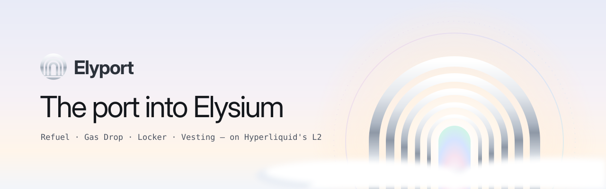

  

<h3 align="center">The port into Elysium</h3>

  Gas from any chain, airdrops to thousands, and locks and vesting that traders can verify, 
  all in one place on Elysium, the Hyperliquid L2.

---

### What Elyport does

| Tool | For | What it does |
| --- | --- | --- |
| **Refuel** | Users | Get HYPE for gas on Elysium, paid from Ethereum, Base, Arbitrum, Robinhood Chain, BNB Chain, Solana or HyperEVM |
| **Gas Drop** | Builders | Send HYPE or any token to thousands of wallets from one list or CSV |
| **Locker** | Builders | Lock LP and tokens until a set date, each with a public, verifiable page |
| **Vesting** | Builders | Release team and investor tokens on a schedule with a cliff, claim by claim |
| **Explore** | Traders | Check any token's locks and vesting before buying |

### Principles

- **Verifiable by default.** Every lock and schedule has a public page anyone can check.
- **Capped and careful.** Instant refuels are limited per transaction and per wallet.
- **No token required.** Fees are paid in HYPE.

### Links

Website and X are coming soon.

---

Elyport is an independent tool. Not affiliated with Kinetiq or Elysium.
